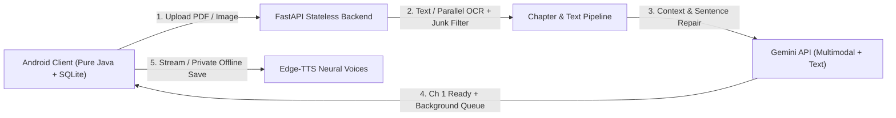

# speakAi

A **Native Android (Java)** + **FastAPI** audiobook and document narrator built around a **stateless, zero-server-storage** architecture. Users can instantly listen to screenshots and single-page documents via **Quick Read**, or import full multi-chapter books and scanned PDFs into an offline-capable on-device library with real-time progress tracking, multilingual neural narration, and background playback.

---

## Architecture Overview



### Engineering Highlights

- **Zero Server Storage:** All parsed books, chapter metadata, reading progress (`%`), and downloaded audio files remain exclusively on the user's device (`SQLite` + app-private internal storage). Temporary audio files generated on the backend are automatically purged within 20 minutes.
- **Two-Mode Home Experience:**
  - **Quick Read:** Extracts text from photos, screenshots, or single-page documents (with multimodal vision support) and streams directly to the player without cluttering the library.
  - **Save Book:** Processes full books and scanned PDFs asynchronously with **real-time progress (`%`) and dynamic ETA**.
- **Background Chapter Sync & Priority Preemption:** Chapter 1 is refined immediately on import for instant playback while remaining chapters refine in a background server queue and sync silently into local SQLite. Selecting any uncleaned middle/final chapter promotes it to the front of the queue on demand.
- **Indian Scanned PDF Pipeline:** Automatically skips cover repeats, copyright/publisher notices, pin codes, and index pages, upscales low-resolution scans (`2x` grayscale + contrast boost) before parallel Tesseract OCR, and repairs broken Devanagari context and wrapped sentences.
- **Background & Offline Playback:** Runs an Android `ForegroundService` (`mediaPlayback`) with lock-screen controls, variable speed (`0.8x`–`1.5x`), multilingual translation (`hi`, `mr`, `gu`, `bn`, `ta`, `te`, `en`), and private app-scoped MP3 caching.

---

## Tech Stack

| Layer | Technologies |
| :--- | :--- |
| **Android Client** | Pure Java, Material Components, RecyclerView, SQLite (`SQLiteOpenHelper`), OkHttp 4, AndroidX Media `ForegroundService` |
| **Backend API** | Python 3.10+, FastAPI, Uvicorn |
| **Parsing & OCR** | PyPDF, python-docx, Pillow, Tesseract OCR (`hin`, `eng`, `mar`, `guj`, `ben`, `tam`, `tel`) |
| **AI & Narration** | Google Gemini REST API (Vision + Proofreading + Story Translation), Microsoft `edge-tts` Neural Voices |
| **Deployment** | Docker (`python:3.10-slim` + Tesseract + FFmpeg) |

---

## Project Structure

```text
speakAi/
├── android/                                      # Native Android (Pure Java) project
│   └── app/src/main/java/com/speakai/app/
│       ├── MainActivity.java                     # Bookshelf, Quick Read & Save Book flows, live ETA dialog
│       ├── BookDetailActivity.java               # Chapter list, overall progress, real-time sync updates
│       ├── AudioPlayerActivity.java              # Chunked streaming, offline cache, language/speed/voice UI
│       ├── adapters/
│       │   ├── BookAdapter.java
│       │   └── ChapterAdapter.java
│       ├── database/
│       │   └── AppDatabaseHelper.java            # Local SQLite persistence & file cleanup
│       ├── models/
│       │   ├── Book.java
│       │   ├── Chapter.java
│       │   └── QuickReadHolder.java
│       ├── network/
│       │   ├── ApiClient.java                    # OkHttp client + configurable server endpoint
│       │   └── ChapterSyncManager.java           # Background SQLite chapter synchronization
│       └── services/
│           └── AudioPlayerService.java           # Foreground media playback service
│
├── backend/                                      # Stateless Python FastAPI backend
│   ├── app.py                                    # REST endpoints & CORS setup
│   ├── doc_parser.py                             # PDF/DOCX/TXT/Image extraction, parallel OCR, junk filter
│   ├── chapter_parser.py                         # Chapter & act segmentation
│   ├── gemini_engine.py                          # Multimodal Vision, proofreading & failover client
│   ├── parse_job_manager.py                      # Async upload jobs with live progress % & ETA
│   ├── polish_job_manager.py                     # Background chapter queue with priority preemption
│   ├── session_manager.py                        # Chunked TTS streaming + 20-minute auto-purge
│   ├── chunker.py                                # Sentence-boundary audio chunking
│   ├── translator.py                             # Cross-language translation with script detection
│   ├── tone_analyzer.py                          # Storytelling vs. formal pacing detector
│   ├── tts_engine.py                             # Multi-language Edge-TTS voice mapping
│   ├── Dockerfile                                # Production container with Tesseract & FFmpeg
│   ├── requirements.txt
│   └── .env.example
│
├── run_server.sh                                 # Local development launcher
└── .gitignore
```

---

## Local Setup

### 1. Backend Setup

```bash
cd backend
python3 -m venv venv
source venv/bin/activate
pip install -r requirements.txt
```

Create `backend/.env` from the template:

```bash
cp .env.example .env
```

Add your Gemini API key in `backend/.env`:

```env
GEMINI_API_KEY=your_api_key_here
GEMINI_MODEL=gemini-3.1-flash-lite-preview
```

Start the server from the project root:

```bash
./run_server.sh
```

Verify health endpoint at `http://localhost:8000/`.

### 2. Android App Setup

1. Open the `android/` directory in **Android Studio**.
2. Sync Gradle and run on an emulator or physical Android device (`minSdk 24`, `targetSdk 34`).
3. Tap the top-right **Settings (`⚙️`)** icon in the app to point to your local machine's IP (e.g., `http://192.168.x.x:8000`), emulator loopback (`http://10.0.2.2:8000`), or deployed HTTPS URL.

---

## Deploying Backend with Docker (Render)

1. Push this repository to GitHub (`.gitignore` protects `backend/.env` and build artifacts).
2. Create a **New Web Service** on **Render** connected to your repository:
   - **Root Directory:** `backend`
   - **Runtime:** `Docker`
3. Add environment variables in Render Dashboard:
   - `GEMINI_API_KEY` = `your_api_key_here`
   - `GEMINI_MODEL` = `gemini-3.1-flash-lite-preview`
4. Deploy and copy your `https://your-service.onrender.com` URL into the Android app's **Server Settings** (or update `DEFAULT_BASE_URL` in `ApiClient.java` before building a release APK).
