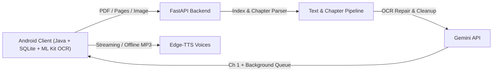

# speakAi

speakAi is a native Android (Java) and FastAPI audiobook/document reader built with on-device storage (`SQLite`) and a stateless backend. You can listen to single-page photos or screenshots using **Quick Read**, or import full multi-chapter books and scanned PDFs into your local library with an extracted Table of Contents, background processing, and offline playback.

## Features

- **On-Device Library Storage:** Books, extracted index text, chapter states, listening progress, and downloaded offline MP3s stay in local `SQLite` and app-private storage. Server sessions and temporary audio files are automatically cleaned up.
- **Quick Read & Save Book Modes:**
  - **Quick Read:** Reads screenshots, photos, or short documents directly into the player without adding them to your library.
  - **Save Book:** Parses multi-chapter books in the background with a non-blocking progress card in the library list and automatic resume on app reopen.
- **Index & Multi-Page Chapter Parsing:**
  - Extracts front-matter Index / Table of Contents pages (`विषय`, `Contents`, `Index`) into a readable text viewer at the top of the book's chapter list (skipped when a book has no index).
  - Segments stories/chapters across page breaks so multi-page chapters stay intact.
- **On-Device OCR + Cloud Fallback:** Uses `PdfRenderer` + Google ML Kit Devanagari OCR on Android for scanned image PDFs (with server-side Tesseract OCR fallback) and `PyPDF` for text-embedded PDFs.
- **Background Chapter Cleanup:** Refines Chapter 1 first for immediate playback, then cleans remaining chapters in a `4.5s`-paced background queue (with instant priority preemption if you open a later chapter directly).
- **Audio Controls & Search:**
  - Sticky bottom mini-player across library and chapter screens with Play/Pause and Stop controls.
  - **Play in Background** toggle on the player screen (auto-pauses on app minimize or screen lock when OFF; continues with media notification controls when ON).
  - Saved per-book and global defaults for **Language** (`hi`, `mr`, `gu`, `bn`, `ta`, `te`, `en`), **Voice Gender**, and **Speed** (`0.8x`–`1.5x`).
  - Live search bars for both books and chapters.
- **English Buddy (Conversational Tutor):** Built-in voice and text practice partner that accepts everyday English or mixed Hindi-English (Hinglish), gently frames cleaner English sentences with simple beginner-level vocabulary, and replies in Indian English neural voices (`en-IN`) with optional hands-free auto-mic and session mistake summaries.

## Architecture



## Tech Stack

| Component | Stack |
| :--- | :--- |
| **Android App** | Java, Material Components, RecyclerView, SQLite (`SQLiteOpenHelper`), OkHttp 4, AndroidX Media Service, `PdfRenderer`, ML Kit Devanagari Text Recognition |
| **Backend** | Python 3.13, FastAPI, Uvicorn |
| **Parsing & OCR** | PyPDF, python-docx, Pillow, Tesseract OCR (`hin`, `eng`, `mar`, `guj`, `ben`, `tam`, `tel`) |
| **Text & Speech** | Gemini REST API, `edge-tts` |
| **Deployment** | Docker (`python:3.13-slim`, Tesseract, FFmpeg) on Render |

## Project Structure

```text
speakAi/
├── android/
│   └── app/src/main/java/com/speakai/app/
│       ├── SpeakAiApp.java
│       ├── MainActivity.java
│       ├── BookDetailActivity.java
│       ├── AudioPlayerActivity.java
│       ├── EnglishTutorActivity.java
│       ├── adapters/
│       │   ├── BookAdapter.java
│       │   ├── ChapterAdapter.java
│       │   └── TutorMessageAdapter.java
│       ├── database/
│       │   └── AppDatabaseHelper.java
│       ├── models/
│       │   ├── Book.java
│       │   ├── Chapter.java
│       │   ├── QuickReadHolder.java
│       │   └── TutorMessage.java
│       ├── network/
│       │   ├── ApiClient.java
│       │   ├── BookUploadManager.java
│       │   └── ChapterSyncManager.java
│       ├── services/
│       │   └── AudioPlayerService.java
│       ├── ui/
│       │   ├── MiniPlayerController.java
│       │   └── SearchBarHelper.java
│       └── utils/
│           ├── DocumentPreProcessor.java
│           └── VoicePrefsHelper.java
│
├── backend/
│   ├── app.py
│   ├── doc_parser.py
│   ├── chapter_parser.py
│   ├── gemini_engine.py
│   ├── parse_job_manager.py
│   ├── polish_job_manager.py
│   ├── session_manager.py
│   ├── chunker.py
│   ├── translator.py
│   ├── tone_analyzer.py
│   ├── tts_engine.py
│   ├── tutor_engine.py
│   ├── Dockerfile
│   ├── requirements.txt
│   └── .env.example
│
├── run_server.sh
└── .gitignore
```

## Local Setup

### Backend

```bash
cd backend
python3 -m venv venv
source venv/bin/activate
pip install -r requirements.txt
cp .env.example .env
```

Add your API key in `backend/.env`:

```env
GEMINI_API_KEY=your_api_key_here
GEMINI_MODEL=gemini-3.1-flash-lite-preview
```

Run from project root:

```bash
./run_server.sh
```

### Android

1. Open `android/` in **Android Studio** (or build via Gradle).
2. Set `DEFAULT_BASE_URL` in `android/app/src/main/java/com/speakai/app/network/ApiClient.java` if pointing to a local server.
3. Build the APK:

```bash
./gradlew -p android assembleDebug
# Output: android/app/build/outputs/apk/debug/speakAi-v1.0.0-debug.apk
```

## Deployment (Render Docker)

1. Push the repository to GitHub (`.gitignore` excludes `backend/.env` and build artifacts).
2. Create a **New Web Service** on Render:
   - **Root Directory:** `backend`
   - **Language / Runtime:** `Docker`
3. Set `GEMINI_API_KEY` and `GEMINI_MODEL` in Render Environment Variables.
4. Deploy and optionally upload the built APK under **GitHub Releases**.
